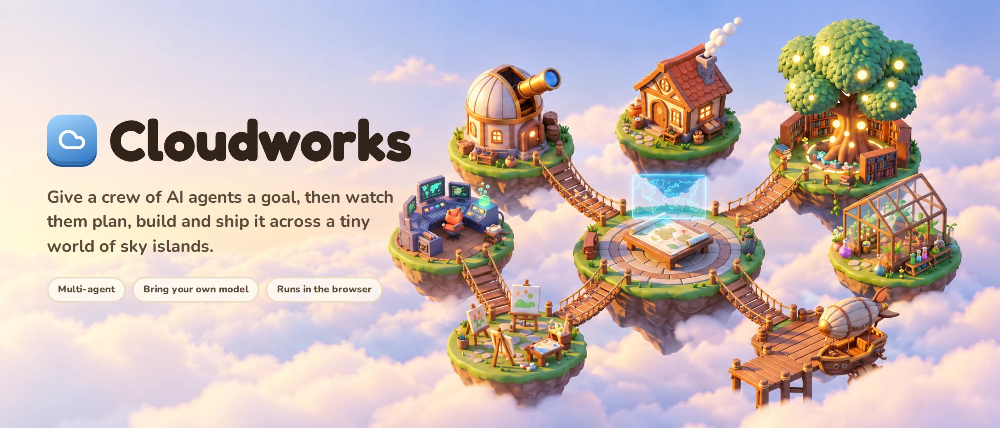
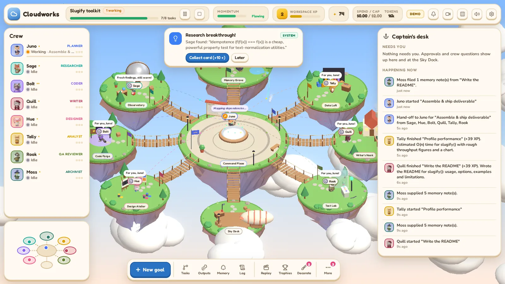
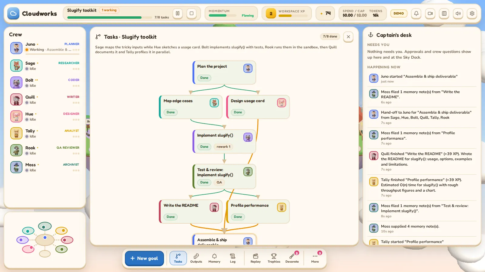
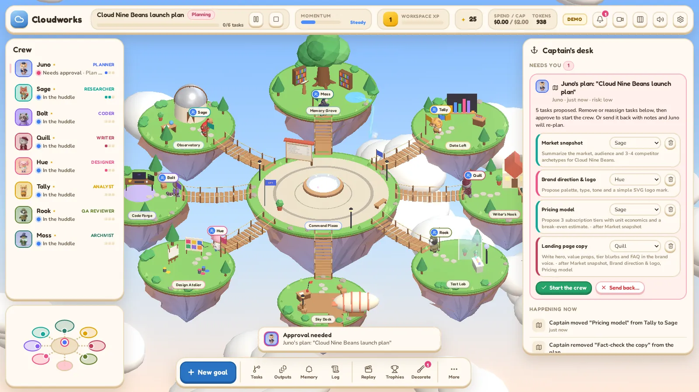
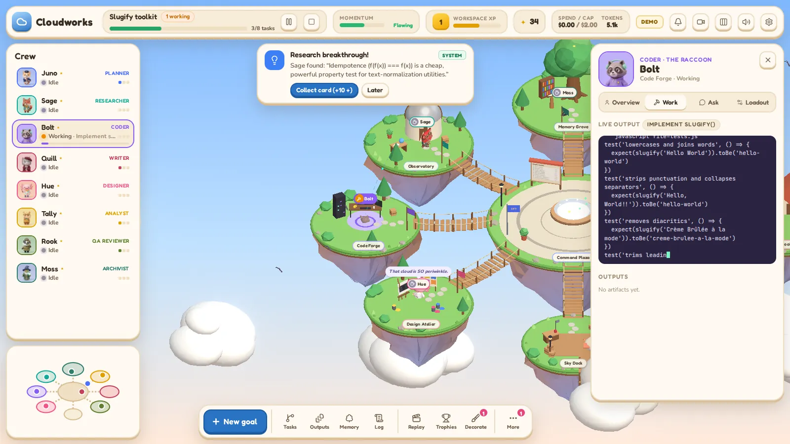
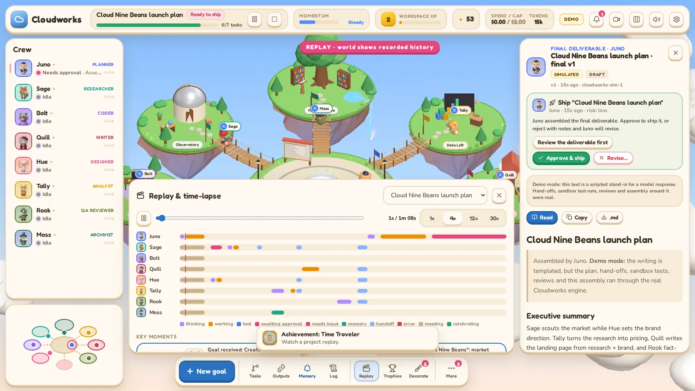
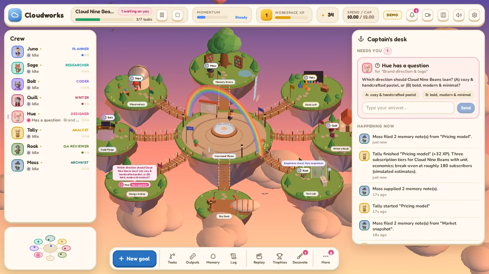
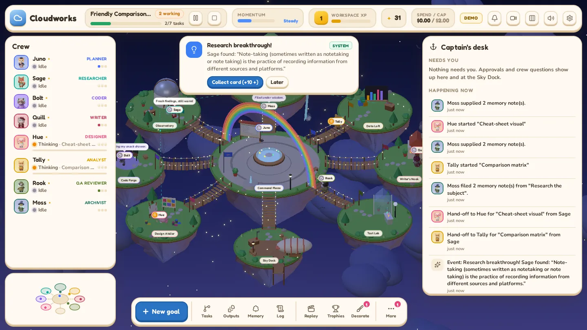
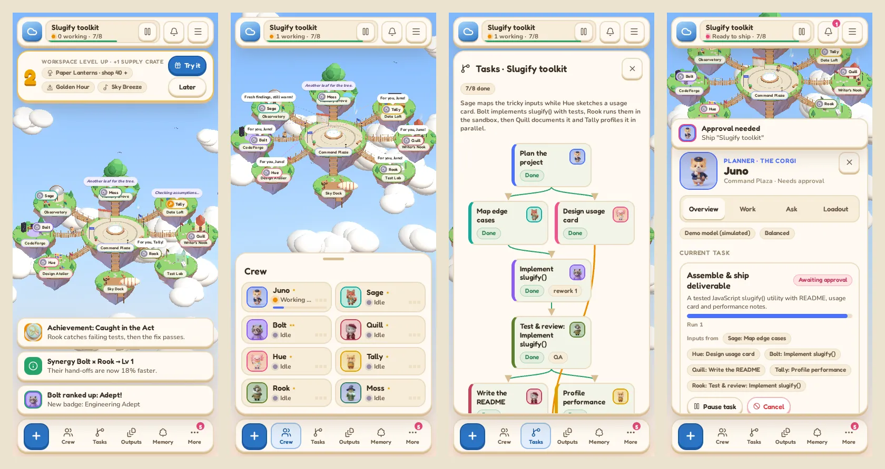

<p align="center">
  
</p>

<p align="center">
  <a href="LICENSE"></a>
  <a href="CONTRIBUTING.md"></a>
  
  
  
</p>

Cloudworks is a multi-agent AI workspace you can watch. Give it a goal and a planner agent turns it into a task graph. Eight specialist agents then work through the graph in parallel, hand their results to each other and ask you before anything leaves your machine. It all plays out on a small world of floating islands, and every animation is driven by real engine state.



## Features

- **Real orchestration.** Goals become a validated task graph. Independent tasks run in parallel, and each agent receives the actual outputs of the tasks it depends on.
- **Bring your own model.** Anthropic, OpenAI, OpenRouter or any OpenAI-compatible server such as Ollama. Every agent can use a different model.
- **Tests that actually run.** The QA agent runs the coder's tests in a sandboxed worker and sends failures back for rework.
- **You stay in charge.** Web requests and shipping wait for your approval. Pause, redirect, reassign or question any agent mid-task.
- **Shared memory.** Notes persist across sessions, with deduplication and conflict detection.
- **Replay.** Every project is recorded and plays back as a time-lapse with a per-agent timeline.
- **Works on phones.** Below 820px the side panels become a tab bar and bottom sheets.
- **Demo mode.** No API key needed. Model text is scripted and clearly labeled; everything around it is real.

## Quick start

Requires Node.js 20.19+ or 22.12+.

```bash
git clone https://github.com/0xNoramiya/cloudwork.git
cd cloudwork
npm install
npm run dev
```

Open http://localhost:5173, click **Enter the workshop**, then **New goal** (or press `G`) and pick a sample goal.

### Use real models

Add a key in one of two ways:

- **In the app:** Settings → Models. Keys stay in this browser's `localStorage` and are never written to saves, logs or exports.
- **On the dev server:** create `.env.local`. The local proxy adds the key server-side, so the browser never sees it.

  ```bash
  ANTHROPIC_API_KEY=sk-ant-...
  OPENAI_API_KEY=sk-...
  OPENROUTER_API_KEY=sk-or-...
  ```

Pick a default model in Settings, or give an agent its own model in its **Loadout** tab. Each provider card has a **Test connection** button.

| Provider | Client |
|---|---|
| Anthropic | Official `@anthropic-ai/sdk` with streaming, per-agent effort, refusal fallback and server-side web search (after your approval) |
| OpenAI, OpenRouter | Official `openai` SDK with streaming |
| Ollama and other OpenAI-compatible servers | Same SDK with a custom base URL (`http://localhost:11434/v1` is pre-filled) |

## How it works

1. **Plan.** The planner returns a task graph with owners and dependencies. The engine validates it, adds a test-and-review step after every coding task, and adds a final assembly step. You can review and edit the plan before work starts.
2. **Schedule.** Any task whose inputs are done becomes ready. Each agent works one task at a time, and different agents work in parallel.
3. **Hand off.** Finished outputs are passed to the next agent's prompt. In the world, the agent carries a parcel across a bridge.
4. **Use tools.** Agents call `web_search`, `fetch_url`, `memory_search`, `run_js` and `ask_user` through a small text protocol. Requests that leave your machine wait at the Sky Dock for approval.
5. **Review.** QA runs the code's tests in an isolated worker with no network access and a hard timeout. Failing tests always mean a failed review, whatever the model says.
6. **Remember.** After each task, the archivist distills notes into shared memory. Later tasks, including ones in future sessions, retrieve the relevant notes.
7. **Ship.** The planner assembles one deliverable and asks for your approval. Reject it with a note and it gets revised.

## The crew

| Agent | Role | Workshop |
|---|---|---|
| Juno the corgi | Planner | Command Plaza |
| Sage the fox | Researcher | Observatory |
| Bolt the raccoon | Coder | Code Forge |
| Quill the cat | Writer | Writer's Nook |
| Hue the axolotl | Designer | Design Atelier |
| Tally the hamster | Analyst | Data Loft |
| Rook the badger | QA reviewer | Test Lab |
| Moss the tortoise | Archivist | Memory Grove |

The Sky Dock is the approval gate: anyone who needs your sign-off walks there and waits.

## Screenshots

| | |
|---|---|
|  |  |
| Task graph, including a QA rework on the code | Editing the plan before the crew starts |
|  |  |
| The inspector streaming Bolt's code live | Replay with a per-agent timeline |
|  |  |
| Golden Hour theme | Starlight theme |



## Real, simulated and cosmetic

- **Always real:** planning, scheduling, hand-offs, tool calls, approvals, sandboxed test runs, review loops, memory, replay, token and cost tracking, and the budget cap.
- **Simulated in Demo mode:** only the text a model would write. It is scripted per goal type and badged "Simulated". For research goals, the researcher still searches the web and quotes real sentences from the page it reads.
- **Cosmetic:** XP, levels, events, themes and decorations. They never change what the models do.

<details>
<summary>Keyboard shortcuts</summary>

| Key | Action | Key | Action |
|---|---|---|---|
| `G` | New goal | `A` | Trophies |
| `T` | Tasks | `F` | Finds |
| `O` | Outputs | `I` | Ideas |
| `M` | Memory | `D` | Decorate |
| `L` | Log | `C` | Style |
| `R` | Replay | `H` | Hide side panels |
| `S` | Stats | `Esc` | Close |
| `P` | Projects | | |

</details>

## Project structure

```
src/
  engine/       orchestration core: scheduler, task runners, approvals, memory, providers
  state/        one zustand store shared by the engine, the 3D world and the UI
  world/        react-three-fiber scene: islands, agents, effects, animation retargeting
  ui/           HUD: top bar, roster, inspector, panels, mobile sheets
server/         Vite middleware: model proxy, web search and fetch
dev/            end-to-end tests, a mock LLM server and capture scripts
```

The engine writes every change to the store, and the world reads the same store every frame. There is no separate animation layer to fall out of sync.

## Development

```bash
npm run typecheck
npm run lint
npm run build
```

End-to-end tests run in headless Chromium against a dev server on port 5199. See [CONTRIBUTING.md](CONTRIBUTING.md) for the full list, including live-mode tests against a mock model server.

`npm run build` produces a static site. Use `npm run preview` to keep the model proxy and web tools. On a static host, provider calls go straight from the browser, which Anthropic and OpenAI allow but some providers block.

## Roadmap

- Multi-user workspaces
- Server-side execution, so work continues after the tab closes
- Native provider tool calling alongside the text protocol
- Embedding-based memory retrieval
- File uploads and code execution beyond JavaScript

## Contributing

Contributions are welcome: bug reports, ideas and pull requests. Read [CONTRIBUTING.md](CONTRIBUTING.md) to get set up.

## License

[MIT](LICENSE) © 2026 kudaliar

Characters, portraits, achievement badges and artwork were generated with [Higgsfield](https://higgsfield.ai). Fonts are Fredoka, Nunito and JetBrains Mono (SIL Open Font License). Icons are from [Lucide](https://lucide.dev) (ISC). Music and sound effects are synthesized in the browser.
